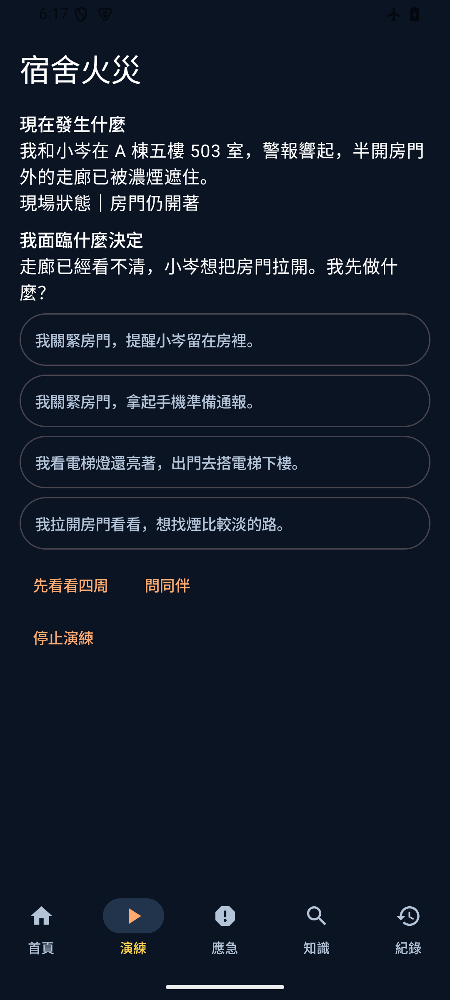
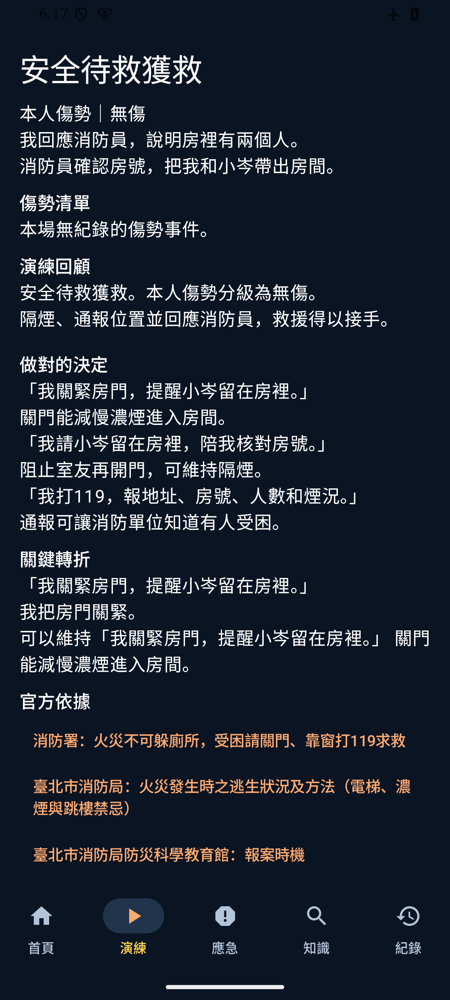

# 步驟 5.2 Android 離線選擇題

宿舍火災和學校地震在 Android 首頁的「開始情境演練」中離線使用。建置從 Web 資料複製到 `assets/packs/`，載入先核對可信清冊的 SHA-256，再驗 schema 與語意引用。既有文字模式可從「演練設定」開啟。

Room 用同一交易存檔與記錄該回合。重開「開始情境演練」會載回已結算的決策、選項順序、傷勢和重來前狀態。研究紀錄支援匯出 NDJSON，保存 pack 版本及摘要、匿名 session、attempt、decision ID 與 occurrence、選項 ID、顯示順序、作答時間、觀察／背景時間、來源、事件、傷勢結局及重來來源。作答時間按裝置單調時鐘計算。App 強制終止後，題目未送出的停留時間重新起算。已完成的回合時間保持原記錄。

## JS／Kotlin 共用比對

| 情境 | 向量 | 檢查點 |
|---|---:|---:|
| 宿舍火災 | 8 | 61 |
| 學校地震 | 8 | 60 |
| 合計 | 16 | 121 |

檢查點比較完整 facts、NPC、曝光、結局、傷勢、當下旁白、題目和排序。每個檢查點後序列化再載入一次。終局另比對完整回顧，涵蓋全對、亂玩、致命、重來、洗牌、觀察／問答與重複送出。JS 重新產生的參考資料與已提交的比對文件一致。Kotlin 在同一組資料逐回合比對。回顧改為只列一項最嚴重傷勢，最早的錯誤延誤優先，傷勢本身獨立保留，關鍵轉折的危險回合保留在最多三則的回顧中。餘震題的窗台選項給出原地玩家可能相信的動機。

## Android API 35 模擬器畫面

以下為飛航模式的宿舍火災路徑。搭電梯到達受困結局後，以同場重來完成無傷獲救。

| 開場提醒 | 一般回合 |
|---|---|
|  |  |

| 致命結局 | 無傷結局與回顧 |
|---|---|
|  |  |

## 重現

- `node online-coach/test/step52-parity.js` 重新產生參考資料。
- `node --test online-coach/test/choice-pack.test.js` 核對 JS 與資料。
- Android 在 `android/` 執行 `gradle testDebugUnitTest assembleDebug assembleDebugAndroidTest --offline` 後，可用 ADB 執行 AndroidJUnitRunner。測試類別 `ChoiceScreenTest` 可加 `pocketkbScreens=true` 擷取畫面。
- OpenAI API 呼叫 0 次。現有真實 API 驗證腳本依本輪要求排除。
- 裝置以兩次 AndroidJUnitRunner 驗證，中途 ADB 強制停止 App，重開後回到先前已結算的學校地震決策。
